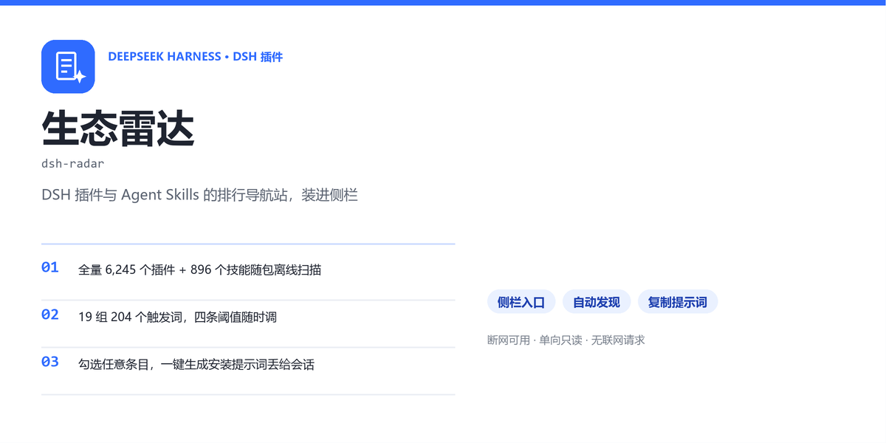

<p align="center"></p>

<p align="center">
  
  
  
  
</p>

---

## 1. 它是什么

侧栏多一个「生态雷达」，点开就是插件与技能排行榜。

社区目录里现在有 6,245 个 DSH 插件，GitHub 上还有 896 个 agent skills 仓库。光靠搜索翻不出重点——你不知道哪个三个月没提交过，也不知道哪些是同一个作者批量发的。这个插件把这些数据打包带进 DSH，在本地扫一遍，按你调的阈值筛出值得看的。

跟静态排名站的区别是最后一步：勾选任意条目，生成一段安装提示词，粘到会话里让 agent 直接装。

<p align="center"></p>

## 2. 为什么是「复制提示词」而不是「一键安装」

插件是在你机器上跑任意代码的东西。做成一个「立即安装」按钮，等于把装载权限交给一个刚打开两分钟的页面。

现在的做法是：页面只负责生成这段文本，装载动作由你自己粘进会话触发。中间那一步你还能改——去掉不想装的、补一句「先看 README 再装」。多花五秒，换来一次确认。

生成的提示词长这样：

```
帮我把下面这些 DSH 扩展装上，装完逐个确认是否真的生效。

## 插件
- dsh-context · https://github.com/xxx/dsh-context
  上下文透视面板
- cc-safety-net · https://github.com/xxx/cc-safety-net
  执行前守卫。破坏性 git 和文件命令、读 SSH 密钥或 .env 的调用，会被它拦下来。

插件用 `dsh plugin --profile <当前 profile> add <包名>` 安装，或走 plugin_manager。
装完到 插件 页确认对应行已启用，把失败的包名和报错贴出来。
```

技能段会换成克隆命令和目标目录，并说明「克隆完不用安装，重启会话后确认能被识别」。

## 3. 自动发现怎么工作

页面里内联了全部记录，扫描在浏览器本地跑。打开插件、改任一个设置，都会重新扫一遍全量 7,141 条，实测 27ms（Node 24，一次性冷扫）。

| 维度 | 内容 |
|---|---|
| 词条字典 | 19 组 204 个词，覆盖记忆 / 上下文 / 搜索 / 浏览器 / 视觉 / 语音 / 界面 / 主题 / 用量 / 模型 / Git / 安全 / 工作流 / 远程 / 通知 / 文档 / 数据 / 娱乐 / 开发 |
| 阈值 | 星标、npm 月下载、最近更新天数、综合分，四条滑块 |
| 开关 | 一起扫技能仓库 / 包含已归档 / 优先最近更新 |
| 命中规则 | 名字、作者、中英简介、分类任一命中即触发；命中词越多排越前，同分看提交时间再看星标 |

三档预设的实测差异：

| 预设 | 星标 | 月下载 | 更新 | 综合分 | 命中 |
|---|---|---|---|---|---|
| 宽松 | 0 | 0 | 365 天 | 30 | 全部 |
| 标准 | 0 | 0 | 180 天 | 40 | 922 条 |
| 严格 | 3,000 | 20,000 | 60 天 | 60 | 118 条 |

阈值和词条状态存在浏览器 `localStorage`，刷新不丢。

## 4. 快速开始

```sh
dsh plugin --profile desktop add github:zz12hui/dsh-radar
```

装完重启 DSH（托盘退出再开，刷新页面不算），侧栏会出现「生态雷达」。

不想留入口了？插件配置里把 `sidebarEntry` 关掉，入口不再注册，`/api/dsh-radar/*` 还能访问。

## 5. 接口

全部只接受同源请求（校验 `sec-fetch-site` 与 `Origin`），只读为主。

| 方法 | 路径 | 说明 |
|---|---|---|
| GET | `/api/dsh-radar/data` | 完整快照，约 2.2 MB |
| GET | `/api/dsh-radar/config` | `{ sidebarEntry }` |
| POST | `/api/dsh-radar/config` | 写入 `sidebarEntry`，走 config editor |
| GET | `/api/dsh-radar/health` | 快照日期、条目数 |

`data` 与 `health` 在 Host 侧缓存 5 分钟，重复打开页面不会反复读盘。

## 6. 数据口径

快照打包在 `data/radar.json`（2.2 MB），字段是定长数组不是对象，省掉一半体积：

```
插件 [id, repo, cat, zh, en, stars, dl, pushed, score, lic]
技能 [id, owner, name, desc, stars, pushed, score, lic]
```

综合分口径：

```
插件 0.50 × 星标 + 0.34 × npm 月下载 + 0.16 × 更新新鲜度
技能 0.62 × 星标 + 0.38 × 新鲜度（150 天窗口）
```

星标和下载各自取 `log10` 再归一化。不这么做，前十名全是几万星的仓库。技能单独按技能池自己的最大值归一——用插件池的最大星标会算出 100 分以上的溢出值。

## 7. 重新生成数据

拿到新快照要重跑整条链路。脚本在 `scripts/`，按顺序执行：

```sh
python scripts/collect.py        # GitHub 搜索，无 token 也能跑，10 次/分
python scripts/fetch-stars.py    # 补星标，约 4.5 次/秒
python scripts/fetch-npm.py      # 补 npm 月下载
python scripts/build-ranking.py  # 合并打分，输出 payload.json
python scripts/build-data.py     # 生成 data/radar.json
```

`collect.py` 会跳过已抓过的查询，中途断了能续。整条链路约十几分钟，主要时间在补星标。

`build-data.py` 读的 `payload.json` 是上一步的产物，中间数据约 59 MB，没进仓库——要重建得先跑完前四步。

## 8. 已知限制

- 快照是打包时的状态，不会自己去 GitHub 刷新。要新数据得重新生成再装一次。
- 星标是仓库级的。一个仓库发十几个插件，它们共享同一个数，别当单插件热度。
- 下载量只对发到 npm 的包有意义，纯 GitHub 条目记 0。
- 上榜不等于安全审查。插件能在你机器上跑任意代码，装之前至少点开仓库看一眼。

## 9. 验证

`tools/verify.mjs` 用 Node 直接把两个纯函数从 `client.js` 里拉出来跑真实快照，不需要浏览器：

```sh
node tools/verify.mjs
```

覆盖 16 项：标准档命中数、全量扫描条数、词条总数、严格档收窄、全关词条归零、关技能开关、单组词条命中、排序单调性、提示词四个段落、空选择占位。

## 10. License

MIT
