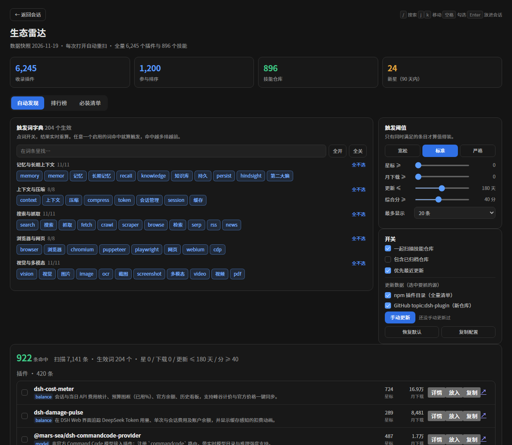
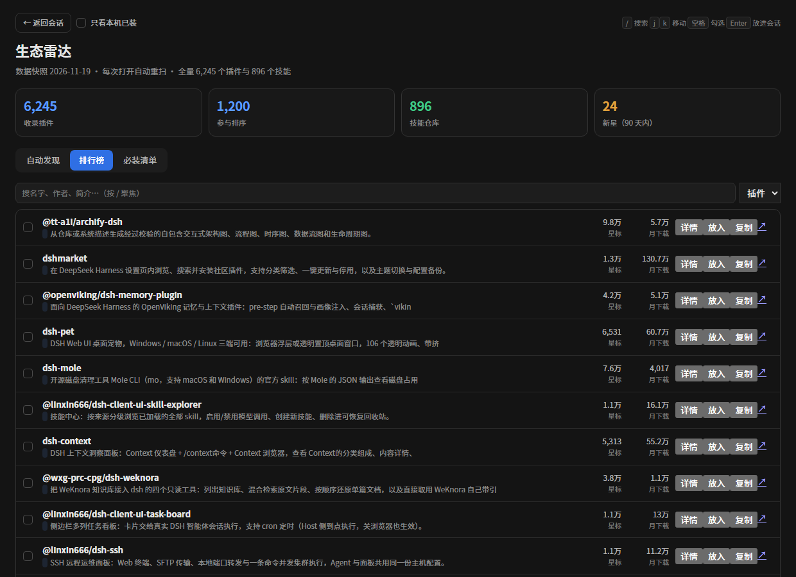
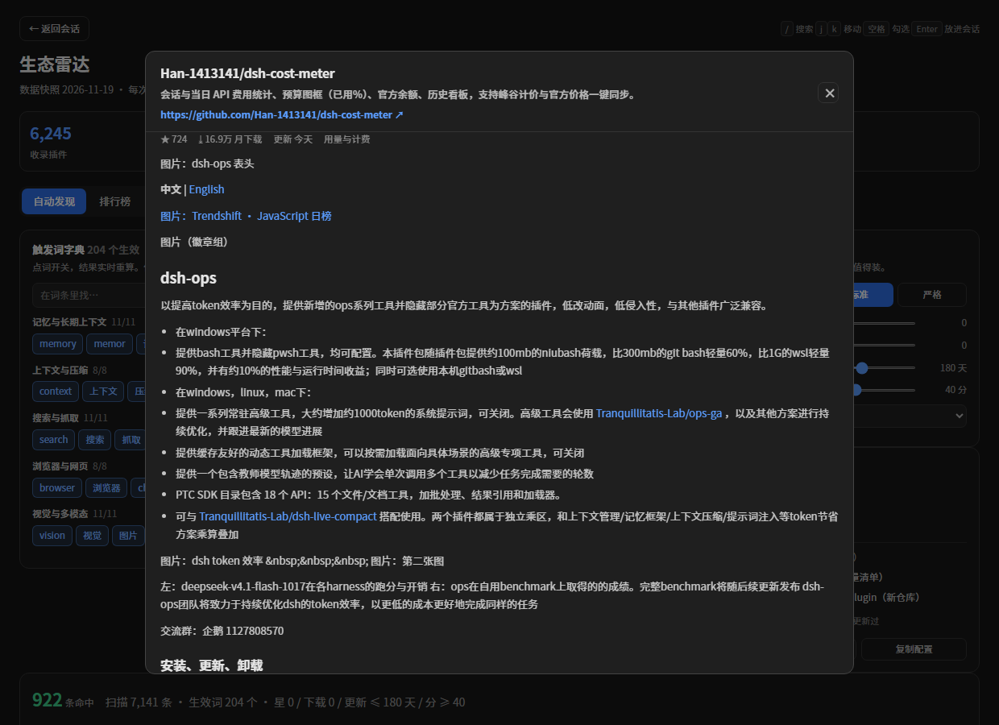

<p align="center"></p>

<p align="center">
  
  
  
  
</p>

---

## 1. 它是什么

侧栏多一个「生态雷达」，点开就是插件与技能排行榜。

社区目录里现在有 6,245 个 DSH 插件，GitHub 上还有 896 个 agent skills 仓库。光靠搜索翻不出重点——你不知道哪个三个月没提交过，也不知道哪些是同一个作者批量发的。这个插件把这些数据打包带进 DSH，在本地扫一遍，按你调的阈值筛出值得看的。

跟静态排名站的区别是最后一步：勾选任意条目，生成一段安装提示词，粘到会话里让 agent 直接装。

<p align="center"></p>





## 2. 为什么是「复制提示词」而不是「一键安装」

插件是在你机器上跑任意代码的东西。做成一个「立即安装」按钮，等于把装载权限交给一个刚打开两分钟的页面。

现在的做法是：页面只负责生成这段文本，装载动作由你自己粘进会话触发。中间那一步你还能改——去掉不想装的、补一句「先看 README 再装」。多花五秒，换来一次确认。

生成的提示词长这样：

```
帮我把下面这些 DSH 扩展装上，装完逐个确认是否真的生效。

## 插件
- dsh-context · https://github.com/xxx/dsh-context
  上下文透视面板，看这次会话被什么吃满了
- cc-safety-net · https://github.com/xxx/cc-safety-net
  执行前守卫：破坏性 git 和文件命令会被拦下，读 SSH 密钥或 .env 的调用也拦。

插件用 `dsh plugin --profile <当前 profile> add <包名>` 安装，或走 plugin_manager。
装完到 插件 页确认对应行已启用，把失败的包名和报错贴出来。
```

技能段会换成克隆命令和目标目录，并说明「克隆完不用安装，重启会话后确认能被识别」。

## 3. 自动发现怎么工作

页面里内联了全部记录，扫描在浏览器本地跑。打开插件、改任一个设置，都会重新扫一遍全量 7,141 条，实测 27ms（Node 24，一次性冷扫）。

| 维度 | 内容 |
|---|---|
| 词条字典 | 19 组 204 个词，覆盖记忆 / 上下文 / 搜索 / 浏览器 / 视觉 / 语音 / 界面 / 主题 / 用量 / 模型 / Git / 安全 / 工作流 / 远程 / 通知 / 文档 / 数据 / 娱乐 / 开发 |
| 阈值 | 四条滑块：星标与月下载各一条，更新天数和综合分各一条 |
| 开关 | 一起扫技能仓库 / 包含已归档 / 优先最近更新 |
| 命中规则 | 名字和作者算一项，中英简介和分类各算一项，任一命中即触发；命中词越多排越前，同分看提交时间再看星标 |

三档预设的实测差异：

| 预设 | 星标 | 月下载 | 更新 | 综合分 | 命中 |
|---|---|---|---|---|---|
| 宽松 | 0 | 0 | 365 天 | 30 | 全部 |
| 标准 | 0 | 0 | 180 天 | 40 | 922 条 |
| 严格 | 3,000 | 20,000 | 60 天 | 60 | 118 条 |

阈值和词条状态存在浏览器 `localStorage`，刷新不丢。

## 4. 快速开始

```sh
dsh plugin --profile desktop add github:zz12hui/dsh-radar
```

装完重启 DSH（托盘退出再开，刷新页面不算），侧栏会出现「生态雷达」。

不想留入口了？插件配置里把 `sidebarEntry` 关掉，入口不再注册，`/api/dsh-radar/*` 还能访问。

## 5. 更新数据

快照有两层：仓库里打包的 `data/radar.json`，和本机缓存 `~/.dsh/cache/dsh-radar/snapshot.json`。缓存存在时优先读缓存，所以更新过的数据重装插件也不会丢。

面板右上「开关」卡片里有「更新数据（选中要抓的源）」，两个源可以单独勾选：

| 数据源 | 抓什么 | 典型耗时 |
|---|---|---|
| npm 插件目录 | `unpkg.com/dsh-plugin-catalog/index.json`，约 6,900 个插件 | 13 秒左右，5.6 MB |
| GitHub topic:dsh-plugin | `search/repositories?q=topic:dsh-plugin`，按星标降序取前 3 页 | 每页 1 秒，未登录限 10 次/分 |

两个都关掉时按钮直接拒，返回「至少选一个数据源再更新」。抓完会写缓存并重算分数，页面自己重载。

合并规则值得知道几条：

- 目录里已有的条目，只更新简介和分类。星标与下载量取两边更大的那个，所以漏勾 npm 也不会把下载量清零。
- GitHub 搜索捡到的新仓库，用 `owner/name` 当 id，标 `src: github`。它们不在 npm 上，下载量记 0。
- 归档仓库不进来。这类仓库不会再收 PR，装上也多半跑不起来。
- `dsh-plugin` topic 被不少无关项目拿来蹭搜索，比如图片上传器和逆向工具。所以新仓库得在名字、简介或别的 topic 里提到 dsh / deepseek / harness，才算数。这一步当前会滤掉四分之一左右。
- 某页没拉下来时，前几页照用，结果行会把少的那页写出来，不会假装全拿到了。
- 分类看仓库 topic 和简介，都对不上就落到 `tools`。
- 综合分对整张表重算。新条目进来后，旧条目的排名也会动。

GitHub 未登录时搜索接口是 10 次/分，够一次更新用。想要更高额度，给 DSH 进程设置 `GITHUB_TOKEN` 环境变量即可，插件会自己带上。

## 6. 看仓库详情

每行末尾四个按钮：**详情 / 放入 / 复制 / ↗**。

「详情」开一个弹窗。上面是仓库名，接着是插件简介和仓库地址。再一行元信息：星标、月下载、更新时间，外加许可证和分类。再往下是 README 正文。



README 走 `api.github.com/repos/<owner>/<name>/readme`，带 `Accept: application/vnd.github.raw`。读完在 Host 侧缓存 40 条、10 分钟，同一个仓库反复点不会重复请求。

渲染前会先把 HTML 压平。图片留 alt 文字，链接留标题和地址。徽章一行接一行出现时，合并成一句「图片（徽章组）」。不这么做，几乎每个 README 的开头都是一屏标签。

超过 400 KB 的 README 会截断，弹窗底部会写明。

末尾那个 ↗ 是普通外链，点一下用系统默认浏览器打开 `https://github.com/<repo>`。

## 7. 拿到条目之后怎么用

勾选几条，底部浮层会亮起来，给三个出口：

| 动作 | 结果 |
|---|---|
| 放进会话 | 退回会话界面，把这批条目写成安装指令塞进输入框，**只写不发送**，你可以改完再自己按回车 |
| 看提示词 | 弹窗预览完整文本，确认无误再复制 |
| 复制 | 直接复制到剪贴板 |

「放进会话」不会覆盖你正在打的内容。输入框里已经有草稿时，新内容追加在后面。

面板里还有这些。

头部左上角是「返回会话」。`Esc` 也能回去，但分两级：提示词弹窗开着就先关弹窗，再按一次才退出面板。

键盘按 Vim 的习惯来。`/` 跳到搜索框，`j` 和 `k` 上下挪光标，空格给光标那行打勾，`Enter` 直接把它放进输入框。光标停在哪行，哪行左侧就有一道蓝条，挪出视野时会自动滚回来。

排行榜顶部有个「只看本机已装」勾选框，12 个在跑的插件一眼就能挑出来。默认不勾。

关闭面板前停在哪个 tab、滚到哪个位置，下次打开原样还给你。状态存在 `sessionStorage` 的 `dsh-radar-ui` 里。

## 8. 接口

全部只接受同源请求（校验 `sec-fetch-site` 与 `Origin`），只读为主。

| 方法 | 路径 | 说明 |
|---|---|---|
| GET | `/api/dsh-radar/data` | 完整快照，约 2.2 MB |
| GET | `/api/dsh-radar/config` | `{ sidebarEntry }` |
| POST | `/api/dsh-radar/config` | 写入 `sidebarEntry`，走 config editor |
| GET | `/api/dsh-radar/health` | 快照日期、条目数 |
| POST | `/api/dsh-radar/refresh` | 抓数据源并写缓存，body `{ npm, github, pages }` |
| GET | `/api/dsh-radar/readme` | `?repo=owner/name`，返回 README 文本 |
| GET | `/api/dsh-radar/status` | 是否正在更新、上次更新时间与结果 |

`data` 与 `health` 在 Host 侧缓存 5 分钟，重复打开页面不会反复读盘。`refresh` 同一时刻只允许跑一次，第二次会返回「正在更新中」。README 参数只接受 `owner/name` 形态，带 `..` 或斜杠数量不对的直接拒。

## 9. 数据口径

快照打包在 `data/radar.json`（2.2 MB），字段是定长数组不是对象，省掉一半体积：

```
插件 [id, repo, cat, zh, en, stars, dl, pushed, score, lic, src]
技能 [id, owner, name, desc, stars, pushed, score, lic]
```

`src` 是来源标记：`npm` 表示来自插件目录，`github` 表示是 topic 搜索新捡到的仓库。

综合分口径：

```
插件 0.50 × 星标 + 0.34 × npm 月下载 + 0.16 × 更新新鲜度
技能 0.62 × 星标 + 0.38 × 新鲜度（150 天窗口）
```

星标和下载各自取 `log10` 再归一化。不这么做，前十名全是几万星的仓库。技能单独按技能池自己的最大值归一——用插件池的最大星标会算出 100 分以上的溢出值。

## 10. 重新生成数据

拿到新快照要重跑整条链路。脚本在 `scripts/`，按顺序执行：

```sh
python scripts/collect.py        # GitHub 搜索，无 token 也能跑，10 次/分
python scripts/fetch-stars.py    # 补星标，约 4.5 次/秒
python scripts/fetch-npm.py      # 补 npm 月下载
python scripts/build-ranking.py  # 合并打分，输出 payload.json
python scripts/build-data.py     # 生成 data/radar.json
```

`collect.py` 会跳过已抓过的查询，中途断了能续。整条链路约十几分钟，主要时间在补星标。

`build-data.py` 读的 `payload.json` 来自上一步。中间数据加起来约 59 MB，没进仓库。想重建，得先把前四步跑完。

## 11. 已知限制

打包进去的快照停在打包那天（当前是 2026-11-19）。点「手动更新」会拉到当天为止的新数据，但拉回来的只落在本机缓存，仓库里的 `data/radar.json` 不会跟着变——想让别人也拿到新快照，得重跑第 10 节那五条脚本再发一版。

星标挂在仓库上，不是包上。`@linxin666/dsh-*` 那十几个插件共享同一个 1.1 万，排名挨得很近是这个原因，不代表每个都有这个热度。

下载量对纯 GitHub 分发的插件恒为 0，所以综合分里它权重压到 0.34，星标仍是主项。

分类是靠 topic 猜的，GitHub 直检进来的仓库尤其容易落到 `tools`。

关于安全：这个站只做排序，不做审查。插件是能往你机器上跑任意代码的东西，`cc-safety-net` 这类守卫也是插件本身。点开仓库看两眼再装，比看分数靠谱。

## 12. 验证

四个脚本都不需要浏览器。

`tools/verify.mjs` 用 Node 把纯函数从 `client.js` 里拉出来，喂真实快照跑。共 21 项断言。

```sh
node tools/verify.mjs
```

它管的是算得对不对：标准档命中 922 条，全量扫描 7,141 条，词条 204 个；严格档收到 118 条，关掉全部词条归零，单开一个词组命中 89 条。排序单调，提示词分段也对。

写入输入框那五种情况也在里面：没有会话时返回失败；空草稿直接写；已有草稿时追加而不覆盖；追加前裁掉尾部空白；写入抛错时不崩。

`tools/load-check.mjs` 管的是挂得上挂不上。它拿一个最小 React 替身加载 `client.js`，跑 `apply()`，然后数 slot 注册。

```sh
node tools/load-check.mjs
```

要看到三条全在：`sidebar.panellist`、`main` 和 `conversation.composer.dock`。少一条，面板还开得出来，但对应功能是哑的。

另两个测 Host 半：

```sh
node tools/merge-check.mjs   # 33 项，合并规则
node tools/routes-check.mjs  # 27 项，六条路由
```

`merge-check.mjs` 拿假的目录条目和 GitHub 仓库跑合并。它查这些：已有行保留星标与下载；新条目追加；`.git` 后缀剥掉；GitHub-only 仓库带星标入库；已知仓库不重复；归档跳过；分数落在 0..100。

`routes-check.mjs` 用假 `webServer` 造请求打六条路由：同源校验，方法校验，README 参数校验（`../etc/passwd`、缺参和不带斜杠的写法全部拒），真实拉一个仓库的 README 并验证第二次命中缓存，两个数据源都关时拒绝更新。它需要联网，其余三个不用。

## 13. License

MIT
